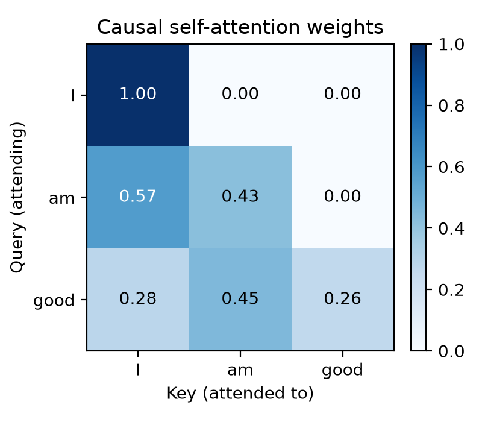

# Part 1: Self-Attention from Scratch

*[Build a Transformer](../) series · Part 1 of 7 · Next: Multi-head attention (coming soon)*

A minimal, single-head causal self-attention block in PyTorch, built while preparing a reading-group walkthrough of [*Attention Is All You Need*](https://arxiv.org/abs/1706.03762) (Vaswani et al., 2017).

**Attention(Q, K, V) = softmax(QKᵀ / √d_k) V** (Section 3.2.1, Eq. 1)

## The idea

Most single-head tutorials set every dimension equal (d_k = d_v = d_model), which hides what each projection does. Here every dimension is different on purpose, so each tensor shape shows where it came from:

| Symbol | Value | Meaning |
|---|---|---|
| `seq_len` | 3 | tokens in *"I am good"* |
| `d_model` | 4 | embedding / residual stream width |
| `d_k` | 2 | query and key width |
| `d_v` | 5 | value width |

## What it shows

1. **Q and K only need to match each other.** Q·Kᵀ is (3×2)·(2×3) → (3×3): one score per token pair. `d_k` doesn't need to match anything else.
2. **The causal mask blocks the future.** `triu(..., diagonal=1)` marks positions above the diagonal; `masked_fill` sets them to −∞, so softmax gives them exactly 0. (Why softmax, and why √d_k? See [Why Softmax?](../../concepts/softmax/).)
3. **V has its own width.** weights·V is (3×3)·(3×5) → (3×5), independent of `d_k`.
4. **W_o is the bridge back.** The attention output is (3×5) but `x` is (3×4); `W_o` (5 → 4) projects back so the residual `x + out` works.

Each row sums to 1. *"I"* sees only itself, *"am"* sees *I, am*, and *"good"* sees the whole prefix.

> **Note:** `x` is random and the weights are untrained, so the pattern shows mechanics, not meaning. In a real model:
> - `x` comes from a **learned embedding table** (token ID → vector) plus **positional encodings**.
> - `W_q`, `W_k`, `W_v`, `W_o` are **learned by training** on a task such as next-token prediction: compute a loss, backpropagate, and update the weights with an optimizer, over many batches.
> - After training, the attention weights become meaningful. For example, a pronoun attends to the noun it refers to (see Figures 3–5 in the paper).

## What the full paper adds

- **Multi-head attention (3.2.2):** h = 8 heads with d_k = d_v = d_model / h = 64. Setting h·d_k = d_model is an engineering choice, not a requirement of attention.
- **Add & Norm (3.1)**, a **position-wise feed-forward layer (3.3)**, and **positional encodings (3.5)**.

## Files

- `attention-demo.ipynb`: the notebook (runs top to bottom in under a second on CPU)
- `heatmap.png`: the attention weights plot
