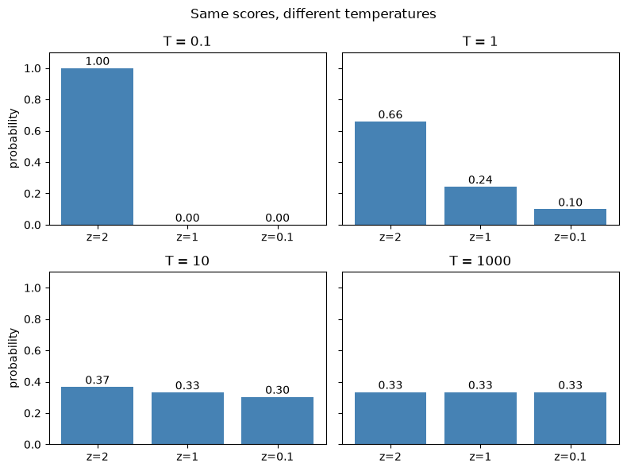
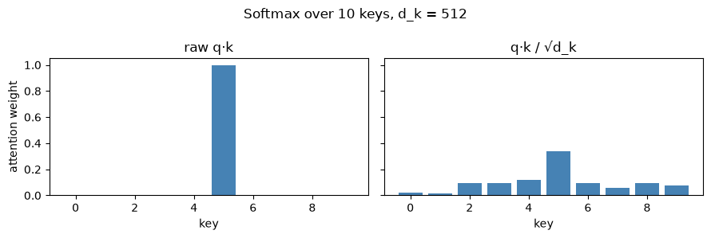

# Why Softmax?

**softmax(z)ᵢ = e^zᵢ / Σⱼ e^zⱼ** turns any vector of scores into a probability distribution. It's at the heart of attention, classification heads, and LLM sampling. This notebook shows, one small demo at a time, why it works so well, and the one weakness that explains why attention divides by √d_k.

## What it shows

| # | Property | Where it shows up |
|---|---|---|
| 1 | Positive outputs that sum to 1 | attention weights, class probabilities |
| 2 | A soft, differentiable argmax | anything trained with gradients |
| 3 | Temperature: sharp vs. flat | LLM sampling |
| 4 | Shift invariance | numerically stable implementations (subtract the max) |
| 5 | −∞ becomes exactly 0 | causal and padding masks |
| 6 | Saturation on large inputs | the √d_k scaling in attention |

## Temperature

Dividing the scores by a temperature T before softmax changes how sharp the result is. Small T gets close to argmax; large T gets close to equal weights. This is the temperature setting used in LLM sampling.

## The √d_k connection

A dot product of two random d_k-dimensional vectors has variance ≈ d_k, so attention scores grow with dimension. With d_k = 512, the raw scores push softmax to an almost one-hot output, and the gradient nearly vanishes:

| Scores | Score std | Max weight | Gradient norm |
|---|---|---|---|
| raw q·k | 19.86 | 1.000 | 3.0e-11 |
| q·k / √d_k | 0.88 | 0.340 | 2.4e-01 |

That's why *Attention Is All You Need* divides by √d_k (Section 3.2.1, footnote 4).

## Related

- [Build a Transformer, Part 1: Self-attention](../../build-a-transformer/01-self-attention/), where softmax turns attention scores into weights
